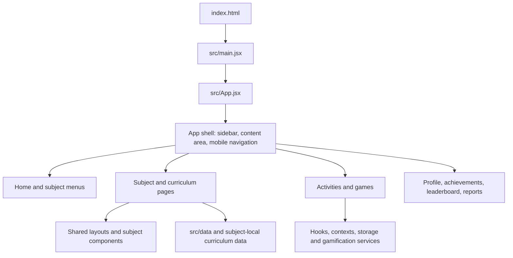

# ImanAI / Math Adventure — Project Structure and Layout

This guide explains how the application starts, how its pages are selected, where the main features live, and how shared layout, state, data, and assets fit together. It describes the current repository structure; feature folders can contain both newer shared patterns and older standalone implementations.

## 1. Project at a glance

The app is a client-side React learning experience for children, built with Vite. It combines subject menus, curriculum pages, short learning activities and games, progress tracking, assessments, and student profile screens.

The main architecture is:



There is no React Router. `src/App.jsx` selects the page from React state. Most feature pages are loaded with `React.lazy()` so their code is downloaded when needed.

## 2. Repository map

```text
.
├── public/                 Static images, illustrations, audio, and sound effects
├── scripts/                Focused development and manual verification scripts
├── docs/                   Product, design, curriculum, and troubleshooting guides
├── src/
│   ├── App.jsx              App state, navigation, route selection, providers
│   ├── main.jsx             React/Vite entry point
│   ├── index.css            Global tokens, app shell, responsive rules
│   ├── components/          Pages, shared layouts, UI and game components
│   ├── contexts/            Shared React context providers
│   ├── data/                Curriculum indexes and reusable question/path data
│   ├── hooks/               Reusable state and browser interaction hooks
│   ├── pages/               Assessment screens
│   ├── services/            Persistence, speech, gamification, migration
│   ├── types/               TypeScript declarations used by JavaScript modules
│   ├── utils/               Localization, sound, math, access and validation helpers
│   └── assets/              Imported/bundled assets
├── index.html               HTML document and font links
├── package.json             Dependencies and npm commands
└── vite.config.js           Vite build/dev configuration
```

### Main `src/components/` areas

| Folder or file | Responsibility |
| --- | --- |
| `HomePage.jsx` | Main dashboard, subject tiles, age-group entry points, and shared dashboard width/layout styles. |
| `_shared/` | Reusable page chrome, hero banners, cards, page containers, and subject-menu layout. |
| `ReadingPage/` | Reading levels, learning activities, games, and reading-specific presentation. |
| `SpeakingPage/` | Speaking/Bahasa Melayu category menu and speech activities. |
| `MathematicsPage/` | Standalone math activities such as operations, clock/time, and Math Journey. |
| `MatematikPage/` | KSSR Matematik curriculum: year selectors, modules, topic hubs, and lesson/game pages. |
| `BahasaMelayuPage/` | KSSR Bahasa Melayu curriculum, organized by year and module. |
| `PendidikanIslamPage/` | Pendidikan Islam curriculum and Jawi learning areas. |
| `AgeGroups/`, `AgeGroup-4-6/`, `AgeGroup-7/`, `AgeGroup-8/`, `AgeGroup-9/` | Age-based screens and a collection of earlier/standalone learning activities. |
| `Achievement/`, `Leaderboard/`, `Profile/` | Progress dashboards, achievements, student profile, and reports. |
| `Formats/` | Reusable question/answer interfaces such as multiple choice, text input, and long method. |
| `icons/`, `SubjectRobots/` | SVG/React icon components, robot artwork, and subject illustrations. |
| `src/pages/` | Assessment selector and assessment session screens. |

The separate names `MathematicsPage` and `MatematikPage` are intentional. `MathematicsPage` is the standalone game menu. `MatematikPage` is the structured KSSR curriculum.

## 3. Startup and page rendering

1. `index.html` provides the `#root` element and loads the app fonts.
2. `src/main.jsx` imports global CSS, mounts `<App />` inside React `StrictMode`, and sets up a guarded reload for Vite chunk-preload errors.
3. `src/App.jsx` loads the saved learner/navigation state, creates the application providers, and renders the selected screen.
4. `DesktopSidebar` and the mobile navigation/footer live in the app shell. The page itself renders inside `.view-container`.
5. The selected page is wrapped in `Suspense`. Lazy-loaded feature chunks use `LoadingSpinner`; transitions can keep the old page visible while the next feature loads.

`App.jsx` is the navigation coordinator. It passes callbacks and shared values such as `language`, `playerName`, `gameState`, theme, and tab navigation to page components. Page components own their local presentation and activity logic.

## 4. Navigation model

Navigation is represented by state in `App.jsx`, not URL routes. Important state includes:

- `activeTab`: learning, profile, leaderboard, achievement, or reports area.
- `currentSubject`: active subject/menu.
- `readingLevel` and `speakingCategory`: selected sub-page for those menus.
- `mathSubGame`, `dateTimeSubGame`, `isPlaying`, and `gameConfig`: standalone math/game flow.
- `matematikYear`, `matematikModule`, `matematikTopic`: KSSR Mathematics flow.
- `islamYear`, `islamModule`, `islamTopic`: Pendidikan Islam flow.
- `bmYear`, `bmModule`, `bmTopic`: KSSR Bahasa Melayu flow.
- `currentAgeGroup` and `currentAgeGame`: age-based activities.
- `selectedAssessment`: the current assessment session, when one is open.
- `language`, `isMuted`, `currentTheme`, `colorMode`, and `streak`: shared presentation, audio, and learner-session preferences/state.

The general curriculum path is:

```text
Home → Subject → Year → Module → Topic or activity
```

Some subjects have a shorter menu-to-game path. The standalone Mathematics menu, for example, selects a subgame and then opens its menu or activity.

`navigate(fn)` wraps navigation updates in React `startTransition`. The keyed `.view-container` remounts for top-level view changes and resets scroll. When adding a new subject’s nested navigation state, add its year/module/topic values to the existing scroll-reset effect in `App.jsx`. Browser-back behavior is handled centrally and should step back from topic to module to subject before leaving the subject.

Navigation state and a subset of appearance/player state are persisted with `src/services/storageService.js`. The app still treats React state as the live source while it is running.

## 5. Shared page layout and width

### App shell

`App.jsx` places the desktop sidebar next to `.app-container`. The page viewport is `.view-container` inside `.app-content`; it is the primary scroll area. Fixed mobile navigation is rendered outside that scrolling element so it stays attached to the viewport. The sidebar may be hidden while a game, assessment, or selected curriculum flow needs the full screen.

### Dashboard and subject-menu pages

`src/components/_shared/SubjectMenuLayout.jsx` supplies reusable page structure: header/back actions, hero area, section heading, topic grid, optional custom children, notice/pending states, and overlays. Pages can supply `heroContent`, `headerContent`, or children when they need a custom section while retaining common chrome.

The home dashboard and standardized subject menus use `HomePageLayoutStyles` from `HomePage.jsx` plus `_shared/PageContainer.css`. `--home-content-max` is set to `1400px` in `index.css`; `.page-container` centers content within that shared maximum, while `.page-layout-root` provides responsive outer gutters. This is the wide dashboard/content-width standard used by Home and the pages sharing its layout styles.

`index.css` also defines `--content-max` for narrower centered content. At desktop widths it changes from `700px` to `800px` at the wide-desktop breakpoint. The desktop `.page-shell` rule and focused game content use this narrower width. These width systems serve different page types: dashboards use the shared 1400px content wrapper, while focused activities may use the narrower game width.

When a page root needs to control its own width or scroll behavior, confirm how it sits inside `.view-container`; avoid placing a narrow `max-width` on the page root when the page is expected to use the dashboard width. For full-bleed roots, follow the existing shell/layout conventions in `index.css` and `_shared/PageContainer.css`.

### Shared visual components

- `StandardHeroBanner` standardizes the responsive dashboard hero content and mascot placement.
- `StandardCard` provides a shared horizontal card style for category/topic lists that opt into it.
- `PageHeaderHero.jsx` contains reusable page header and hero elements.
- `SubjectMenuLayout` supports both standard cards and feature-specific topic variants.

The app uses ordinary CSS files, global CSS, and inline style objects for dynamic values. Tailwind and CSS-in-JS are not part of the project styling approach. Shared CSS variables live in `src/index.css`; subject-specific styles use prefixes such as `rp-*`, `bm-*`, `mt-*`, `pi-*`, `jw-*`, `ops-*`, and `scl-*`.

### Typography

Font files are requested in one Google Fonts stylesheet in [`index.html`](../index.html). The CSS defaults and their common roles are:

| Font | CSS token / common use | Available weights |
| --- | --- | --- |
| Outfit | `--font-heading`; application headings, buttons, labels, and navigation | 400–900 (selected weights loaded) |
| Inter | `--font-body`; default application body and many dashboard descriptions | 400–800 |
| Nunito | Welcome screen and shared menu headings/body fallbacks | 400, 600, 700, 800 |
| Baloo 2 | Playful hero titles, learning/game headings, and score emphasis | 500, 700, 800 |
| Fredoka | Friendly lesson titles, reading hero, and expressive copy | 500, 600, 700 |
| Amiri | Arabic and Jawi text | 400, 700 |

Use the global `--font-heading` and `--font-body` tokens for new general-purpose UI. A feature may opt into a display face (for example, Baloo 2 or Fredoka) when the rest of that feature uses it. Set explicit fallbacks and scope overrides to the feature root; do not change the global body font to restyle one page. Fonts use `display=swap`, so always include a sensible generic fallback.

### Runtime design tokens

The following values are defined in the live `:root` block in [`src/index.css`](../src/index.css). They are the shared base tokens, not a promise that every older feature has already been migrated to use them.

| Token | Current value | Intended role |
| --- | --- | --- |
| `--primary` / `--primary-dark` / `--primary-light` | `#6366F1` / `#4F46E5` / `#E0E7FF` | Indigo primary actions and selected states |
| `--secondary` / `--secondary-dark` / `--secondary-light` | `#F97316` / `#EA580C` / `#FFEDD5` | Orange secondary emphasis |
| `--teal` / `--teal-dark` / `--teal-light` | `#14B8A6` / `#0D9488` / `#CCFBF1` | Teal accent and positive emphasis |
| `--gold` / `--gold-dark` / `--gold-light` | `#F59E0B` / `#D97706` / `#FEF3C7` | Highlights and rewards |
| `--success` / `--success-dark` / `--success-light` | `#10B981` / `#059669` / `#D1FAE5` | Correct answers and completion |
| `--danger` / `--danger-dark` / `--danger-light` | `#EF4444` / `#DC2626` / `#FEE2E2` | Errors and destructive states |
| `--action-blue` / `--action-blue-hover` | `#0674D1` / `#055FAE` | Shared dashboard action treatment |
| `--learning-cta-green` / `--learning-cta-green-dark` | `#078653` / `#066A47` | Learning CTA gradient and hover state |
| `--text-primary` / `--text-secondary` / `--text-light` | `#0F172A` / `#64748B` / `#94A3B8` | Text hierarchy |
| `--bg-body` / `--bg-white` / `--bg-card` / `--bg-muted` | `#F2F8F1` / `#FFFFFF` / `#FFFFFF` / `#F1F5F9` | Base surfaces |
| `--border-color` / `--border-color-light` | `#E2E8F0` / `#F1F5F9` | Standard and subtle borders |
| `--focus-ring` / `--text-on-action` | `var(--primary-dark)` / `#FFFFFF` | Keyboard focus and action foreground |

The actual global primary and secondary colors are indigo and orange. Do not document or assume a different blue/teal pair as the app-wide primary/secondary palette. The app also contains deliberate page-scoped colors and aliases (including legacy `--duo-*` variables); check the owning CSS before changing them.

Some current screen-level treatments illustrate the intended distinction between shared tokens and local design:

| Screen / scope | Current colors | Typography |
| --- | --- | --- |
| Home dashboard (`ih-*`) | Navy text (`#081B49`), pale sky/green surfaces, blue hero emphasis, green accents; scoped in `HomePage.css` and `HomePageLayoutStyles` in `HomePage.jsx`. | Inter base; Baloo 2 hero title; Outfit section headings and card titles. |
| Reading menu (`rp-*`, `mh-*`) | Navy hero text (`#102B62`), blue emphasis (`#0089F9`), muted copy (`#4A5568`), and the shared learning-green CTA; scoped in `ReadingPage.css` and `_shared/SubjectMenuLayout.css`. | Inter menu body; Fredoka hero title and description; Outfit shared section/card headings. |
| Welcome (`wl-*`) | Navy `--wl-navy` (`#071348`), muted `--wl-muted` (`#7382A7`), blue `--wl-blue` (`#147BFF`), and green guest action; declared in `WelcomeModal.css`. | Nunito screen base; Baloo 2 main headings; Fredoka artwork caption. |

These are real feature skins, not additional global tokens. Keep a new feature’s accent decisions coherent with its subject and semantic state, and avoid changing a working feature’s local palette as a side effect of global token edits.

### Spacing, shape, and shell sizing

| Token family | Current values | Guidance |
| --- | --- | --- |
| `--sp-*` | 8, 16, 24, 32, 40, 48, and 64px (`--sp-1` through `--sp-6`, plus `--sp-8`) | Use as the shared spacing scale where the surrounding component uses global tokens. |
| `--border-radius-*` | 10px / 14px / 20px / 100px (`sm`, `md`, `lg`, `pill`) | Reuse for common controls and surfaces; feature cards may use their established scoped radius. |
| `--shadow-sm` / `--shadow-md` | `0 1px 3px rgba(15, 23, 42, .08)` / `0 4px 12px rgba(15, 23, 42, .12)` | Shared low- and medium-elevation shadows. |
| `--home-content-max` | 1400px | Inner width for the wide dashboard and shared subject-menu content. |
| `--content-max` | 700px; 800px at `min-width: 1100px` | Narrower centered reading/game content. |
| `--sidebar-w` | 0px by default; 240px at `min-width: 768px` | Desktop navigation width. |

`body` and `#root` fill and lock the viewport. The application shell owns the scrolling model: `.view-container` scrolls page content, while app-level fixed navigation is rendered outside it. Respect `env(safe-area-inset-*)` on mobile and use `dvh`-aware sizing for full-screen views when available. Do not add a second page-level scroll container unless that page explicitly owns its scrolling.

### Responsive layout rules

- The global desktop-shell breakpoint is 768px: the desktop sidebar appears and the app changes to a row layout. The global wide-content breakpoint is 1100px.
- The root font size is reduced below 400px and enlarged for desktop. Component text should use `rem`, `clamp()`, or its established responsive rules rather than assuming every viewport has the same root size.
- Component breakpoints are not all identical. Home, shared subject menus, and the welcome screen have additional width-, height-, orientation-, and container-based rules. Read the owning stylesheet before reusing a breakpoint.
- The Home and Reading menu styles use a container named `iman-page`; card columns respond to the page’s available width, not only the physical viewport.
- Test short landscape and small-height screens as well as narrow portrait screens. The welcome screen deliberately rearranges content at both width and height breakpoints.

### Theme and dark mode

`App.jsx` owns `colorMode`, applies it to `document.documentElement.dataset.colorMode`, and persists it through the appearance storage helpers. CSS opts into dark appearance with selectors such as `html[data-color-mode='dark']`. Support is implemented by individual page/shared styles; it is not safe to assume every legacy game stylesheet has a complete dark palette. When adding a dark treatment, scope it to the page and verify text, controls, borders, illustrations, and focus rings in both modes.

### CSS ownership and component styling

- Global resets, tokens, shell behavior, and cross-cutting primitives belong in `src/index.css`.
- Reusable page structure and shared subject-menu behavior belong in `src/components/_shared/`; keep its CSS aligned with its component props.
- Feature styles belong beside the feature (`HomePage.css`, `ReadingPage.css`, `WelcomeModal.css`, or the relevant subject stylesheet). Follow the existing `ih-*`, `rp-*`, `wl-*`, `mt-*`, `pi-*`, `jw-*`, `ops-*`, and `scl-*` prefixes.
- Use inline styles only for values that are genuinely dynamic, such as a runtime theme color or asset URL. Avoid accumulating one-off global selectors or duplicating a shared layout rule in each page.
- `HomePageLayoutStyles` in `HomePage.jsx` injects shared, scoped layout rules used by both Home and Reading. If changing those rules, check both pages and preserve the `iman-layout` scoping so unrelated screens do not inherit them.

### Shared accessibility and interaction baseline

Use semantic headings/sections, real buttons for actions, visible `:focus-visible` states, descriptive accessible names, and meaningful image alternatives (decorative art should have empty alt text or be hidden from assistive technology). Keep interactive targets usable on touch screens, maintain readable contrast in both color modes, and respect `prefers-reduced-motion`. Do not rely on color or hover alone to communicate a state.

## 6. Subject and feature flows

### Home and account dashboards

[`HomePage.jsx`](../src/components/HomePage.jsx) composes the dashboard from `SubjectMenuLayout`, `PageHeader`, `StandardHeroBanner`, and `StandardCard`. The main sections are the personalized hero, subject cards, and age-group buttons. Subject access is checked through `subjectAccess`; locked cards remain visible, are disabled, and expose a lock label/icon. Clicking an available entry calls a callback into `App.jsx`, which changes the selected subject or age-group state.

The root uses `ih-root iman-layout page-layout-root`; its inner content uses the 1400px `.page-container`. Desktop keeps the four age groups in a row; tablet and mobile styles reduce the columns. The subject grid adapts between one, two, and three columns based on available width. The dashboard owns its scoped navy/sky/green skin rather than inheriting the global palette directly.

### Reading

[`ReadingPage.jsx`](../src/components/ReadingPage/ReadingPage.jsx) owns the reading menu and maps the six displayed levels to the reading learning pages and challenge. It reuses `SubjectMenuLayout`, the Home/Reading shared layout styles, and `StandardHeroBanner`; it lazy-loads the larger lesson/challenge screens and wraps those routes in `Suspense` with a loading fallback. `selectedLevel` is coordinated by `App.jsx` and the page returns to the level menu through the provided callback.

Reading-specific appearance lives in [`ReadingPage.css`](../src/components/ReadingPage/ReadingPage.css) and the shared menu stylesheet. The desktop hero places copy and artwork side-by-side; narrow layouts stack/reflow the hero. The topic grid uses three columns on desktop and a smaller responsive layout on mobile. Preserve the `rp-*` prefix and the shared subject-menu chrome when changing this screen.

### Welcome and guest entry

[`WelcomeModal.jsx`](../src/components/WelcomeModal.jsx) is rendered when there is no saved player name. It portals the full-viewport welcome/sign-in experience to `document.body`, so its fixed overlay does not change the app’s scroll layout. Its design and responsive behavior are isolated in [`WelcomeModal.css`](../src/components/WelcomeModal.css) under `.wl-*`.

The screen supports BM/English copy, a responsive hero/artwork and sign-in card, and a native guest-name dialog. The component currently presents email/password, social sign-in, registration, and related sign-in controls as disabled UI; guest entry is the active path and calls `onSave` with a trimmed name. Do not describe the disabled controls as a working authentication integration.

The modal makes the app root inert, moves focus into the modal, traps Tab navigation, restores focus around the guest dialog, and supplies dialog labels. Preserve these behaviors and the `aria-*` relationships. Its stylesheet has width, height, portrait/landscape, safe-area, and reduced-motion rules; do not simplify it to a width-only mobile breakpoint.

### Speaking and Bahasa Melayu

`SpeakingPage/BMPage.jsx` is the speaking/category interface. The separate `BahasaMelayuPage/` folder is the newer KSSR curriculum structure, with home/year selection, module navigation, shared lesson/quiz components, and year/module lesson folders.

### Standalone Mathematics and KSSR Mathematics

`MathematicsPage/MathHome.jsx` opens the standalone operations, time, and journey experiences. The KSSR subject is under `MatematikPage/`; it follows the year → module → topic pattern and has its own navigation state in `App.jsx`. Read `MatematikPage/MATEMATIK.md` before changing that curriculum: it contains the topic identifiers, curriculum mapping, migration plan, and feature-specific conventions.

### Pendidikan Islam and Jawi

`PendidikanIslamPage/` has the curriculum home/module navigation and shared subject components. Jawi is routed through the Pendidikan Islam subject state. Read `PendidikanIslamPage/PENDIDIKAN_ISLAM.md` before extending that curriculum.

### Age groups, progress, and assessments

Age-group screens are available through `AgeGroups/` and the `AgeGroup-*` folders. `Achievement/`, `Leaderboard/`, and `Profile/` provide progress destinations. `src/pages/AssessmentSelector.jsx` and `AssessmentPage.jsx` implement assessment selection/session screens; `src/utils/assessmentValidator.js` validates assessment data.

## 7. State, persistence, and services

| File or area | Role |
| --- | --- |
| `src/contexts/GamificationContext.jsx` | Provides the repository-backed gamification context. |
| `src/hooks/useGamification.js`, `useTopicGamification.js` | Access shared curriculum/topic gamification state. |
| `src/hooks/useGameState.js` | Reads and updates game-specific progress/rewards. |
| `src/services/GamificationRepo.js` | Defines the gamification repository contract. |
| `src/services/LocalGamificationRepo.js` | Current local persistence implementation for that contract. |
| `src/services/storageService.js` | Legacy/general localStorage helpers for learner info, navigation, and appearance. |
| `src/services/legacyMigration.js` | Moves older saved progress into the newer storage model when needed. |
| `src/services/SpeechManager.js` | Singleton wrapper for browser speech synthesis/recognition. |
| `src/utils/soundManager.js` | Sound effects, hover sounds, and mute behavior. |
| `src/utils/localization.js`, `bilingual.jsx` | Shared translation/localization helpers. |

The default gamification repository is local-first. The repository interface keeps storage access behind a service boundary so another implementation can be introduced without making UI components directly depend on storage details.

For quiz/assessment components, keep correct answers out of render-visible question state when using the ref-hidden answer pattern described in the project conventions. On correct answers, the standard celebration uses `canvas-confetti` and `soundManager`.

## 8. Data and public assets

- `src/data/curriculum.js` and `ageCurriculum.js` provide curriculum/age-group indexes.
- `src/data/curriculum/` contains topic-level data where applicable; many larger curriculum modules also keep data beside the subject that owns it.
- `src/data/letterPaths.js` and `numberPaths.js` provide tracing paths.
- `src/utils/` contains shared question logic, math generation, time data, Jawi content, validation, access rules, and statistics helpers.
- `public/images/` stores public-facing artwork organized by feature (home, reading, speaking, mathematics, profile, achievement, and others).
- `public/audio/` stores lesson/speech audio; `public/sounds/` stores short game feedback effects.
- `src/assets/` is for assets imported through the module graph; `public/` assets are referenced by URL and copied as-is by Vite.

When adding assets, follow the neighboring feature’s convention and ensure the path works with the configured Vite base URL, especially for GitHub Pages deployment.

## 9. Development commands

```bash
npm install
npm run dev       # Start Vite locally
npm run build     # Create production files in dist/
npm run preview   # Serve the production build locally
npm run lint      # Run ESLint
npm run deploy    # Build and publish dist/ with gh-pages
```

The package does not define a single `npm test` command. `scripts/` contains focused manual or feature-specific checks (for example, homepage, navigation, layout, profile, and game checks); inspect the individual script before running it because some are browser/desktop-specific.

## 10. Adding or changing a feature

1. Find the owning subject folder and check its local reference document and existing sibling pages.
2. Keep navigation state in `App.jsx`. Follow the existing parent → child state flow and add new nested state to the persistence, scroll-reset, and browser-back logic where needed.
3. Pass navigation and shared app values into the feature with props. Use `React.lazy()` for feature/game chunks where the app already follows that pattern.
4. Reuse `_shared/` layouts and cards where the page fits their structure; use a page-specific wrapper only when its content genuinely has a different flow.
5. For a new page with a custom internal width, check the desktop behavior of its root inside `.view-container` and use the shared page/container patterns to avoid accidental narrowing or overflow.
6. Keep curriculum IDs and topic data aligned with the subject reference docs. Coming-soon curriculum items remain visible as disabled entries rather than disappearing.
7. Use `SpeechManager`, `soundManager`, and gamification hooks/services rather than duplicating browser APIs or local persistence inside a page.

## 11. Frontend implementation checklist

Use this checklist when adding or restyling a page:

1. **Find the owner**: identify the route/state in `App.jsx`, the page component, shared layout, and stylesheet. Read the neighboring feature reference before changing curriculum/game pages.
2. **Choose the correct shell**: use the app shell’s `.view-container` and existing page layout (`SubjectMenuLayout`, `PageContainer`, or the feature’s established standalone layout). Do not add React Router or an independent global navigation system.
3. **Set width at the right level**: full-bleed page roots should stretch; center content in an inner wrapper. Use the existing 1400px dashboard width or 700/800px game width as appropriate. Recheck desktop rules that constrain direct `.view-container` children.
4. **Reuse tokens and styles**: use global font/color/spacing/radius tokens when they fit. Keep feature-only styles scoped and follow its current font and palette; do not impose a new accent globally.
5. **Preserve behavior**: keep navigation callback/state patterns, lazy loading, loading fallbacks, and scroll reset behavior consistent. Include new nested navigation state in the scroll-reset effect when required.
6. **Build responsive and accessible states together**: account for keyboard focus, disabled/locked/loading states, text wrapping, safe areas, dark mode where supported, reduced motion, and short viewports.
7. **Use project asset conventions**: public assets live under `public/` and are referenced with `import.meta.env.BASE_URL` where needed; imported module assets belong in `src/assets/`.
8. **Verify the affected page**: use `npm run lint` and `npm run build` for code changes. Existing targeted browser checks include `scripts/test-homepage.mjs`, `scripts/test-welcome.mjs`, and `scripts/test-welcome-responsive.mjs`; inspect their setup before running. Documentation-only edits do not require a build.

## 12. Related project references

- [Math KSSR reference](../src/components/MatematikPage/MATEMATIK.md)
- [Pendidikan Islam reference](../src/components/PendidikanIslamPage/PENDIDIKAN_ISLAM.md)
- [Bahasa Melayu reference](../src/components/BahasaMelayuPage/BAHASA_MELAYU.md)
- [UI/UX documentation](UI_UX_DOCUMENTATION.md)
- [Reading page layout notes](../src/components/ReadingPage/ReadingPage_UI_UX_LAYOUT.md)
- [GitHub-to-production publishing workflow](END_TO_END_AI_APPLICATION_PUBLISHING_WORKFLOW.md)
- [Game development protocol](Game_Development_Protocol.md)
- [Assessment module guide](ASSESSMENT_MODULE_GUIDE.md)
- [Assessment troubleshooting](ASSESSMENT_TROUBLESHOOTING.md)
- [Blank page debugging](BLANK_PAGE_DEBUG.md)
- [Math Journey implementation guide](Math_Journey_Implementation_Guide.md)
