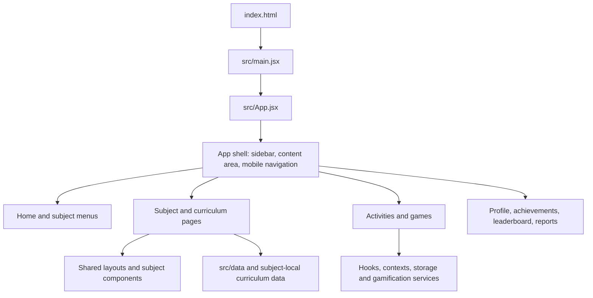

# ImanAI / Math Adventure — Project Structure and Layout

This guide explains how the application starts, how its pages are selected, where the main features live, and how shared layout, state, data, and assets fit together. It describes the current repository structure; feature folders can contain both newer shared patterns and older standalone implementations.

## 1. Project at a glance

The app is a client-side React learning experience for children, built with Vite. It combines subject menus, curriculum pages, short learning activities and games, progress tracking, assessments, and student profile screens.

The main architecture is:



There is no React Router. `src/App.jsx` selects the page from React state. Most feature pages are loaded with `React.lazy()` so their code is downloaded when needed.

## 2. Repository map

```text
.
├── public/                 Static images, illustrations, audio, and sound effects
├── scripts/                Focused development and manual verification scripts
├── docs/                   Product, design, curriculum, and troubleshooting guides
├── src/
│   ├── App.jsx              App state, navigation, route selection, providers
│   ├── main.jsx             React/Vite entry point
│   ├── index.css            Global tokens, app shell, responsive rules
│   ├── components/          Pages, shared layouts, UI and game components
│   ├── contexts/            Shared React context providers
│   ├── data/                Curriculum indexes and reusable question/path data
│   ├── hooks/               Reusable state and browser interaction hooks
│   ├── pages/               Assessment screens
│   ├── services/            Persistence, speech, gamification, migration
│   ├── types/               TypeScript declarations used by JavaScript modules
│   ├── utils/               Localization, sound, math, access and validation helpers
│   └── assets/              Imported/bundled assets
├── index.html               HTML document and font links
├── package.json             Dependencies and npm commands
└── vite.config.js           Vite build/dev configuration
```

### Main `src/components/` areas

| Folder or file | Responsibility |
| --- | --- |
| `HomePage.jsx` | Main dashboard, subject tiles, age-group entry points, and shared dashboard width/layout styles. |
| `_shared/` | Reusable page chrome, hero banners, cards, page containers, and subject-menu layout. |
| `ReadingPage/` | Reading levels, learning activities, games, and reading-specific presentation. |
| `SpeakingPage/` | Speaking/Bahasa Melayu category menu and speech activities. |
| `MathematicsPage/` | Standalone math activities such as operations, clock/time, and Math Journey. |
| `MatematikPage/` | KSSR Matematik curriculum: year selectors, modules, topic hubs, and lesson/game pages. |
| `BahasaMelayuPage/` | KSSR Bahasa Melayu curriculum, organized by year and module. |
| `PendidikanIslamPage/` | Pendidikan Islam curriculum and Jawi learning areas. |
| `AgeGroups/`, `AgeGroup-4-6/`, `AgeGroup-7/`, `AgeGroup-8/`, `AgeGroup-9/` | Age-based screens and a collection of earlier/standalone learning activities. |
| `Achievement/`, `Leaderboard/`, `Profile/` | Progress dashboards, achievements, student profile, and reports. |
| `Formats/` | Reusable question/answer interfaces such as multiple choice, text input, and long method. |
| `icons/`, `SubjectRobots/` | SVG/React icon components, robot artwork, and subject illustrations. |
| `src/pages/` | Assessment selector and assessment session screens. |

The separate names `MathematicsPage` and `MatematikPage` are intentional. `MathematicsPage` is the standalone game menu. `MatematikPage` is the structured KSSR curriculum.

## 3. Startup and page rendering

1. `index.html` provides the `#root` element and loads the app fonts.
2. `src/main.jsx` imports global CSS, mounts `<App />` inside React `StrictMode`, and sets up a guarded reload for Vite chunk-preload errors.
3. `src/App.jsx` loads the saved learner/navigation state, creates the application providers, and renders the selected screen.
4. `DesktopSidebar` and the mobile navigation/footer live in the app shell. The page itself renders inside `.view-container`.
5. The selected page is wrapped in `Suspense`. Lazy-loaded feature chunks use `LoadingSpinner`; transitions can keep the old page visible while the next feature loads.

`App.jsx` is the navigation coordinator. It passes callbacks and shared values such as `language`, `playerName`, `gameState`, theme, and tab navigation to page components. Page components own their local presentation and activity logic.

## 4. Navigation model

Navigation is represented by state in `App.jsx`, not URL routes. Important state includes:

- `activeTab`: learning, profile, leaderboard, achievement, or reports area.
- `currentSubject`: active subject/menu.
- `readingLevel` and `speakingCategory`: selected sub-page for those menus.
- `mathSubGame`, `dateTimeSubGame`, `isPlaying`, and `gameConfig`: standalone math/game flow.
- `matematikYear`, `matematikModule`, `matematikTopic`: KSSR Mathematics flow.
- `islamYear`, `islamModule`, `islamTopic`: Pendidikan Islam flow.
- `bmYear`, `bmModule`, `bmTopic`: KSSR Bahasa Melayu flow.
- `currentAgeGroup` and `currentAgeGame`: age-based activities.
- `selectedAssessment`: the current assessment session, when one is open.
- `language`, `isMuted`, `currentTheme`, `colorMode`, and `streak`: shared presentation, audio, and learner-session preferences/state.

The general curriculum path is:

```text
Home → Subject → Year → Module → Topic or activity
```

Some subjects have a shorter menu-to-game path. The standalone Mathematics menu, for example, selects a subgame and then opens its menu or activity.

`navigate(fn)` wraps navigation updates in React `startTransition`. The keyed `.view-container` remounts for top-level view changes and resets scroll. When adding a new subject’s nested navigation state, add its year/module/topic values to the existing scroll-reset effect in `App.jsx`. Browser-back behavior is handled centrally and should step back from topic to module to subject before leaving the subject.

Navigation state and a subset of appearance/player state are persisted with `src/services/storageService.js`. The app still treats React state as the live source while it is running.

## 5. Shared page layout and width

### App shell

`App.jsx` places the desktop sidebar next to `.app-container`. The page viewport is `.view-container` inside `.app-content`; it is the primary scroll area. Fixed mobile navigation is rendered outside that scrolling element so it stays attached to the viewport. The sidebar may be hidden while a game, assessment, or selected curriculum flow needs the full screen.

### Dashboard and subject-menu pages

`src/components/_shared/SubjectMenuLayout.jsx` supplies reusable page structure: header/back actions, hero area, section heading, topic grid, optional custom children, notice/pending states, and overlays. Pages can supply `heroContent`, `headerContent`, or children when they need a custom section while retaining common chrome.

The home dashboard and standardized subject menus use `HomePageLayoutStyles` from `HomePage.jsx` plus `_shared/PageContainer.css`. `--home-content-max` is set to `1400px` in `index.css`; `.page-container` centers content within that shared maximum, while `.page-layout-root` provides responsive outer gutters. This is the wide dashboard/content-width standard used by Home and the pages sharing its layout styles.

`index.css` also defines `--content-max` for narrower game/reading content. At desktop widths it changes from `700px` to `800px` at the wide-desktop breakpoint. `.page-shell` uses that narrower reading width. These width systems serve different page types: dashboards use the shared 1400px content wrapper, while focused activities may use the narrower game width.

When a page root needs to control its own width or scroll behavior, confirm how it sits inside `.view-container`; avoid placing a narrow `max-width` on the page root when the page is expected to use the dashboard width. For full-bleed roots, follow the existing shell/layout conventions in `index.css` and `_shared/PageContainer.css`.

### Shared visual components

- `StandardHeroBanner` standardizes the responsive dashboard hero content and mascot placement.
- `StandardCard` provides a shared horizontal card style for category/topic lists that opt into it.
- `PageHeaderHero.jsx` contains reusable page header and hero elements.
- `SubjectMenuLayout` supports both standard cards and feature-specific topic variants.

The app uses ordinary CSS files, global CSS, and inline style objects for dynamic values. Tailwind and CSS-in-JS are not part of the project styling approach. Shared CSS variables live in `src/index.css`; subject-specific styles use prefixes such as `rp-*`, `bm-*`, `mt-*`, `pi-*`, `jw-*`, `ops-*`, and `scl-*`.

### Fonts and responsive styling

The fonts are linked in `index.html`. The global token defaults are Outfit for headings and Inter for body copy. Baloo 2 and Fredoka are used by playful lesson/game interfaces, while Amiri is used for Arabic/Jawi text. Keep responsive behavior in the relevant component stylesheet or shared layout stylesheet and preserve reduced-motion support where animations are used.

## 6. Subject and feature flows

### Home and account dashboards

`HomePage.jsx` presents subject and age-group entry points. The shared shell provides its header and banner; clicking a subject calls a callback into `App.jsx`, which changes the selected subject state. Profile, achievement, leaderboard, and report pages receive account and progress values from the app shell.

### Reading

`ReadingPage/ReadingPage.jsx` owns the reading menu/level selection. The `games/` subfolder contains focused reading activities such as the reading game. Reading-specific layout and visuals live alongside these pages in `ReadingPage.css` and related files. `App.jsx` coordinates the selected reading level and activity navigation.

### Speaking and Bahasa Melayu

`SpeakingPage/BMPage.jsx` is the speaking/category interface. The separate `BahasaMelayuPage/` folder is the newer KSSR curriculum structure, with home/year selection, module navigation, shared lesson/quiz components, and year/module lesson folders.

### Standalone Mathematics and KSSR Mathematics

`MathematicsPage/MathHome.jsx` opens the standalone operations, time, and journey experiences. The KSSR subject is under `MatematikPage/`; it follows the year → module → topic pattern and has its own navigation state in `App.jsx`. Read `MatematikPage/MATEMATIK.md` before changing that curriculum: it contains the topic identifiers, curriculum mapping, migration plan, and feature-specific conventions.

### Pendidikan Islam and Jawi

`PendidikanIslamPage/` has the curriculum home/module navigation and shared subject components. Jawi is routed through the Pendidikan Islam subject state. Read `PendidikanIslamPage/PENDIDIKAN_ISLAM.md` before extending that curriculum.

### Age groups, progress, and assessments

Age-group screens are available through `AgeGroups/` and the `AgeGroup-*` folders. `Achievement/`, `Leaderboard/`, and `Profile/` provide progress destinations. `src/pages/AssessmentSelector.jsx` and `AssessmentPage.jsx` implement assessment selection/session screens; `src/utils/assessmentValidator.js` validates assessment data.

## 7. State, persistence, and services

| File or area | Role |
| --- | --- |
| `src/contexts/GamificationContext.jsx` | Provides the repository-backed gamification context. |
| `src/hooks/useGamification.js`, `useTopicGamification.js` | Access shared curriculum/topic gamification state. |
| `src/hooks/useGameState.js` | Reads and updates game-specific progress/rewards. |
| `src/services/GamificationRepo.js` | Defines the gamification repository contract. |
| `src/services/LocalGamificationRepo.js` | Current local persistence implementation for that contract. |
| `src/services/storageService.js` | Legacy/general localStorage helpers for learner info, navigation, and appearance. |
| `src/services/legacyMigration.js` | Moves older saved progress into the newer storage model when needed. |
| `src/services/SpeechManager.js` | Singleton wrapper for browser speech synthesis/recognition. |
| `src/utils/soundManager.js` | Sound effects, hover sounds, and mute behavior. |
| `src/utils/localization.js`, `bilingual.jsx` | Shared translation/localization helpers. |

The default gamification repository is local-first. The repository interface keeps storage access behind a service boundary so another implementation can be introduced without making UI components directly depend on storage details.

For quiz/assessment components, keep correct answers out of render-visible question state when using the ref-hidden answer pattern described in the project conventions. On correct answers, the standard celebration uses `canvas-confetti` and `soundManager`.

## 8. Data and public assets

- `src/data/curriculum.js` and `ageCurriculum.js` provide curriculum/age-group indexes.
- `src/data/curriculum/` contains topic-level data where applicable; many larger curriculum modules also keep data beside the subject that owns it.
- `src/data/letterPaths.js` and `numberPaths.js` provide tracing paths.
- `src/utils/` contains shared question logic, math generation, time data, Jawi content, validation, access rules, and statistics helpers.
- `public/images/` stores public-facing artwork organized by feature (home, reading, speaking, mathematics, profile, achievement, and others).
- `public/audio/` stores lesson/speech audio; `public/sounds/` stores short game feedback effects.
- `src/assets/` is for assets imported through the module graph; `public/` assets are referenced by URL and copied as-is by Vite.

When adding assets, follow the neighboring feature’s convention and ensure the path works with the configured Vite base URL, especially for GitHub Pages deployment.

## 9. Development commands

```bash
npm install
npm run dev       # Start Vite locally
npm run build     # Create production files in dist/
npm run preview   # Serve the production build locally
npm run lint      # Run ESLint
npm run deploy    # Build and publish dist/ with gh-pages
```

The package does not define a single `npm test` command. `scripts/` contains focused manual or feature-specific checks (for example, homepage, navigation, layout, profile, and game checks); inspect the individual script before running it because some are browser/desktop-specific.

## 10. Adding or changing a feature

1. Find the owning subject folder and check its local reference document and existing sibling pages.
2. Keep navigation state in `App.jsx`. Follow the existing parent → child state flow and add new nested state to the persistence, scroll-reset, and browser-back logic where needed.
3. Pass navigation and shared app values into the feature with props. Use `React.lazy()` for feature/game chunks where the app already follows that pattern.
4. Reuse `_shared/` layouts and cards where the page fits their structure; use a page-specific wrapper only when its content genuinely has a different flow.
5. For a new page with a custom internal width, check the desktop behavior of its root inside `.view-container` and use the shared page/container patterns to avoid accidental narrowing or overflow.
6. Keep curriculum IDs and topic data aligned with the subject reference docs. Coming-soon curriculum items remain visible as disabled entries rather than disappearing.
7. Use `SpeechManager`, `soundManager`, and gamification hooks/services rather than duplicating browser APIs or local persistence inside a page.

## 11. Related project references

- [Math KSSR reference](../src/components/MatematikPage/MATEMATIK.md)
- [Pendidikan Islam reference](../src/components/PendidikanIslamPage/PENDIDIKAN_ISLAM.md)
- [Bahasa Melayu reference](../src/components/BahasaMelayuPage/BAHASA_MELAYU.md)
- [UI/UX documentation](UI_UX_DOCUMENTATION.md)
- [Game development protocol](Game_Development_Protocol.md)
- [Assessment module guide](ASSESSMENT_MODULE_GUIDE.md)
- [Assessment troubleshooting](ASSESSMENT_TROUBLESHOOTING.md)
- [Blank page debugging](BLANK_PAGE_DEBUG.md)
- [Math Journey implementation guide](Math_Journey_Implementation_Guide.md)
